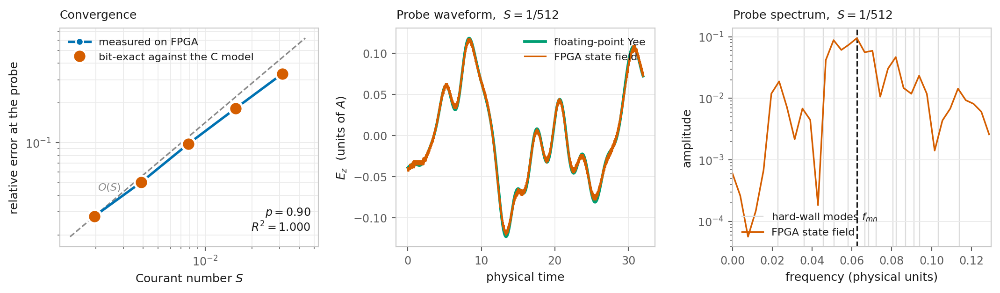

# Ternary FDTD on an FPGA

A finite-difference time-domain electromagnetic solver whose field
variables are restricted to the ternary alphabet **{−1, 0, +1}**,
running on a Tang Nano 20K (Gowin GW2AR-18C) with **no multipliers, no
floating-point unit, and two bits of inter-cell communication per field
component**.

Built with the open-source flow: yosys → nextpnr-himbaechel → Apicula →
openFPGALoader.



## The result

The hardware is **bit-exact against a C reference model over 172,032
consecutive time steps** — every emitted symbol and every state
accumulator value identical, 100.000 %, at S = 1/256 on a 32×32 grid.
Not "agrees to within a tolerance": identical.

Alongside that:

| | |
|---|---|
| Wave arrival at the probe | step 2637 measured, step 2637 predicted |
| Cavity eigenfrequencies | 8 modes within 1.10 % RMS of $f_{mn}=\sqrt{m^2+n^2}/2(N_x-1)$ |
| Frame integrity | 172,032 frames, 0 resyncs, 0 duplicates, 0 drops |
| Multipliers used | **0** (`MULT9X9`, `MULT18X18`, `MULT36X36`, `ALU54D` all zero) |
| Logic | 1342 / 20736 LUT4, 1034 / 15552 DFF, 12 / 46 BSRAM — 6.5 % of the device |
| Timing | 128.1 MHz achieved against a 27 MHz clock |

The relative error at the probe falls as $S^{0.90}$ ($R^2 = 0.9997$)
over a factor of 16 in the Courant number, against $S^{0.934}$ reported
for the scheme in software — **first-order convergence measured in
silicon.**

| $S$ | relative error |
|---|---|
| 1/32 | 0.3332 |
| 1/64 | 0.1814 |
| 1/128 | 0.0979 |
| 1/256 | 0.0502 |
| 1/512 | 0.0277 |

Every point is bit-exact against the C model, so these are not two
implementations that happen to agree — they are the same computation,
one of them performed by an FPGA with no multiplier in it.

## What makes this different from the obvious ternary scheme

The obvious construction — quantise the field, subtract the threshold
back out of the accumulator — does not work. Draining the accumulator
removes the time integration and leaves an algebraic system that
supports no propagating wave.

| | naive scheme | this core |
|---|---|---|
| state accumulator | drained by the threshold | **never drained** |
| quantiser | threshold and hold | noise-shaped, $N(z)=(1-z^{-1})(1-\tfrac12 z^{-1})$ |
| encoder registers | none | `e1`, `e2` per component per cell |
| anti-windup | none | hard clamp at $\pm 2M$ |
| Courant number | absent ($S=1$) | $S = 2^{\text{MC\_LOG}-\text{M\_LOG}}$, a build parameter |

Each cell holds an integer state `a` representing the field `a·A/M`,
which accumulates the discrete curl of its neighbours' **symbols** for
all time. What it publishes is a two-bit symbol produced from that
state by a noise-shaped encoder carrying its own error registers. The
encoder pushes its quantisation error towards the Nyquist frequency,
while the grid's dispersion relation confines every physical mode below
$f_{\max}=\pi^{-1}\arcsin(S\sqrt2)$ — so the Courant number doubles as
the encoder's oversampling ratio, $\mathrm{OSR}\simeq1.11/S$.

## No multipliers

This is the claim the design exists to demonstrate, so nothing is left
implicit:

- `3*e1` is written `(e1 <<< 1) + e1`
- `/2` and `round(v/M)` are arithmetic shifts by constants
- `s*M` is a three-way select between `+M`, `0` and `−M`
- `MC * (symbol difference)` is a constant shift of a value in `[−4,+4]`
- the cell address `y*NX + x` is a bit concatenation, which requires
  `NX`, `NY` to be powers of two

and synthesis runs `yosys -nodsp`, so a multiplier creeping back in is a
build failure rather than a silent regression.

## Quick start

```bash
source ~/fpga-tools/oss-cad-suite/environment

make sim          # four verification layers, all must pass
make              # synthesise, place, route, pack
make flash        # program to SRAM
make capture      # capture the probe stream (~2.5 min)
make spectrum     # analyse it
make spectrum MC=5   # ... or one capture from a sweep
```

Requires `gcc`, `iverilog`, the oss-cad-suite, Octave with
`instrument-control`, and Python with `pyserial`, `numpy`, `matplotlib`.

## Verification

Four layers, in increasing scope. The first two run without any
hardware; the third needs a simulator; the fourth needs the board.

1. **Encoder algebra** — 19,683 vectors covering both signs, the
   saturation boundary and the anti-windup boundary, generated by
   `golden/enc_vectors.c` and replayed against the RTL.
2. **FSM sequencing and BRAM read latency** — `golden/fsm_check.py`
   replays the state machine cycle by cycle, modelling the two-cycle
   read latency explicitly. This is the detail most likely to be wrong
   and least likely to look wrong: an off-by-one there reads a stale
   neighbour and the solver still produces plausible output.
3. **The whole solver** — `sim/tb_fdtd_ternary.v` compares the RTL
   against the C model step by step. Bit-exact, no tolerance.
4. **Framing** — `sim/tb_top_fdtd.v` decodes the serial line the way
   the host does and asserts one frame per step with a contiguous step
   byte, in diagnostic mode so the payload is non-zero.

The C golden model is the single source of truth. It writes
`build/params.vh` and `build/sine_lut.hex`, and the simulation, the
synthesis **and the host analysis scripts** all read those files — so
they cannot disagree about the grid, `M`, `MC`, the source frequency or
the probe cell.

## Protocol

Host → board, single bytes: `R` reset, `G` run, `S` stop, `D`
diagnostic (report the source sample instead of the field), `F` field.

Board → host, one 5-byte frame per completed step:

```
[0] 0xA5          sync marker
[1] symbol        int8, one of -1, 0, +1
[2] state high    int16 big-endian: the accumulator a
[3] state low       field value = a * A / M
[4] step low      step_count[7:0], +1 every frame
```

The solver **stalls until its frame has gone out**, so one frame is one
step exactly. The step byte is not decoration: a decimated or
duplicated stream decodes perfectly and looks like a field, and the only
symptom is a sample rate wrong by an integer factor — which silently
rescales the entire frequency axis.

`led0` is a 1 Hz heartbeat. `led1` blinks at about 7.5 Hz while frames
are leaving the chip, so a stalled core is visible without a host.

## Reproducing the convergence measurement

```bash
make sweep                 # rebuild, reflash and capture at 5 Courant numbers
make convergence-figure
make spectrum MC=4
(FDTD_MC=4 octave --persist host/fdtd_spectrum.m)
```

`make sweep` runs `MC_LOG` = 8, 7, 6, 5, 4 — that is S from 1/32 to
1/512 — and saves, for each point, the capture, **its own
`params.vh`**, and the matching reference run. It prints the bitstream
checksum at every step; **these must all differ.** Identical checksums
mean the build did not change and the sweep is worthless.

**The analysis truncates every run to a common physical time.** The
capture is a fixed number of *steps*, so the physical time $T = NS$
spans a factor of 16 across the sweep. Comparing those directly
measures error accumulated over different durations and reports
$p = 1.18$ rather than $0.90$ — a plausible-looking number that answers
a different question. A convergence study holds $NS$ constant.

## Layout

```
rtl/
  top_fdtd_hw.v      synthesis top; includes build/params.vh
  top_fdtd.v         UART protocol, framing, LEDs
  fdtd_ternary.v     the solver: memories, FSM, source, probe
  tern_encode.v      the noise-shaped encoder (combinational)
  top_echo.v         bisection: UART echo only
  top_blast.v        bisection: frame sender with a timer for the solver
  uart_rx.v uart_tx.v
sim/                 three self-checking testbenches
golden/              C reference model, encoder vectors, FSM replay
host/                capture, spectrum, convergence figure, raw byte dump
constr/              pin and timing constraints
```

## Things that cost time, recorded so they do not cost it again

Every one of these produced output that looked entirely plausible.

- **A free-running transmit timer.** An earlier design stepped at
  1350 Hz and transmitted at 10 Hz, so the host received every 135th
  step while the analysis labelled the axis with the step rate. The
  captured stream was indistinguishable from white noise. Hence the
  stall-until-sent handshake and the step byte.
- **Octave integer saturation.** `fread` returns `uint8`, and integer
  arithmetic in Octave saturates within its class instead of promoting:
  `payload(2)*256` evaluates to 255, and `v - 256` to 0. Every negative
  field sample read back as +255 and every `−1` symbol as 0. This was
  misdiagnosed for hours as a hardware fault. Cast to `double` on read.
- **A serial port left open.** A script-local `safe_close` goes out of
  scope before `onCleanup` runs, the cleanup throws, and the port stays
  open — after which the next opener reads nothing for ever while every
  other layer looks healthy. `safe_close` is its own file for this
  reason.
- **`flash` versus `flash-persist`.** `flash-persist` erases SRAM to
  write flash and leaves the device unconfigured until it reboots. Use
  `flash` while iterating.
- **A Make target that did not depend on its parameters.** The golden
  binary depended only on its `.c` file, so changing `MC_LOG` — a `-D`
  flag — did not trigger a recompile, `params.vh` kept its old values,
  and five sweep points produced byte-identical bitstreams. The binary
  name now carries the parameters.
- **`.DEFAULT_GOAL`.** Make takes the first target in the file, which
  changes meaning whenever a target is added above another. It is now
  set explicitly.
- **A reference run shorter than the capture.** `HW_NSTEP` and the
  capture length were separate numbers. The analysis truncates to the
  shorter record, so the coarse-`S` points disappeared entirely: their
  transient alone exceeded the reference. The capture length now comes
  from `params.vh`, like everything else.

- **Fixed step count is not fixed physical time.** $T = NS$, so a
  sweep that captures the same number of steps at every $S$ compares
  runs of different duration. The fitted order came out at 1.18 instead
  of 0.90, and nothing about the figure looked wrong.

The pattern in five of these seven is the same: **a number written down in
two places, which then drifted.** The project now keeps every physical
parameter in `build/params.vh`, written by the C model, and read by the
simulation, the synthesis and the host scripts alike.

## License

MIT.
